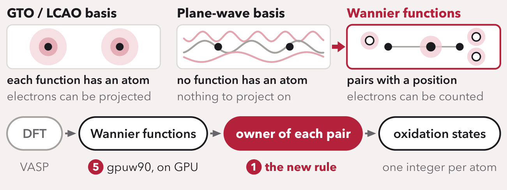
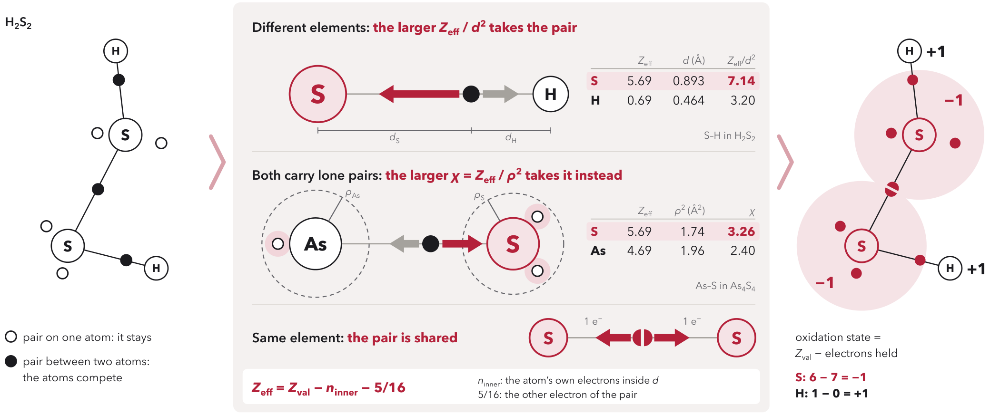
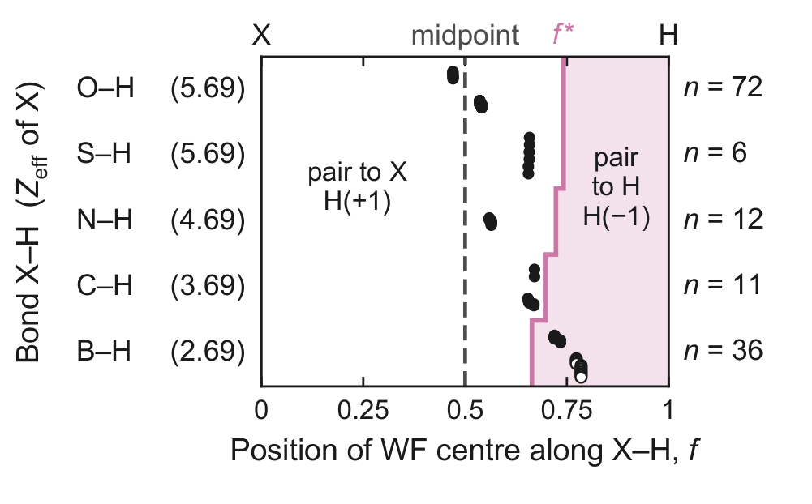
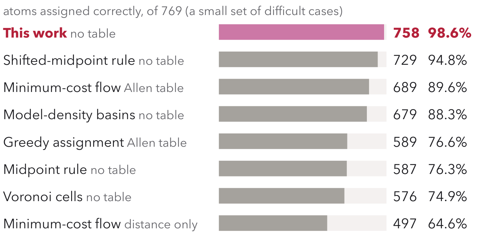
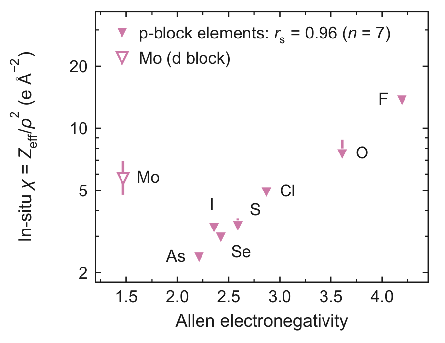
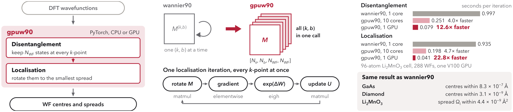

# LEOS: Lattice Effective Oxidation States

LEOS assigns an integer oxidation state to every atom of a solid from the
Wannier functions of a plane-wave DFT (VASP) calculation. Each atom's pull on
a bond pair is computed from its own Wannier functions: no electronegativity
table, no fitted parameter.

| Part | What it does |
|---|---|
| [patch/](patch/) | Patch for VASP 6.4.3: Wannier step and assignment inside VASP; writes the EOSCAR file |
| [pyleos/](pyleos/) | Reads EOSCAR; assignment, diagnostics, reliability index, benchmarks. Python standard library only |
| [gpuw90/](gpuw90/) | The disentanglement and localisation steps of wannier90 in PyTorch, on a CPU or a GPU |

## Why Wannier functions?

DFT does not output oxidation states. With atom-centred basis sets (GTO,
LCAO), every electron can be projected onto an atom. Plane waves, the standard
for solids, belong to no atom: there is nothing to project on. Wannier
functions (WFs) turn plane-wave states back into localised electron pairs, and
one question remains: which atom owns a bond pair? LEOS lets the calculation
decide.

<p align="center">
  
</p>

## 1. A parameter-free assignment rule

A pair that sits on one atom stays there. A pair between two atoms is
contested, and the atoms compete for it:

| The two ends | Who takes the pair |
|---|---|
| Different elements | the larger *Z*<sub>eff</sub> / *d*<sup>2</sup> |
| Both carry lone pairs | the larger *χ* = *Z*<sub>eff</sub> / *ρ*<sup>2</sup> instead |
| Same element | shared |

*Z*<sub>eff</sub> = *Z*<sub>val</sub> − *n*<sub>inner</sub> − 5/16, where *d*
is the distance from the atom to the WF centre, *n*<sub>inner</sub> counts the
atom's own electrons inside *d*, 5/16 is the screening by the other electron
of the pair, and *ρ*<sup>2</sup> is the second moment of the atom's lone-pair
WFs about its nucleus. The oxidation state is *Z*<sub>val</sub> minus the
electrons held: in H<sub>2</sub>S<sub>2</sub>, S is 6 − 7 = −1 and H is
1 − 0 = +1.

<p align="center">
  
</p>

The rule is the frozen plugin
[pyleos/methods/frozen/r3-T-B-cap-repair.py](pyleos/methods/frozen/r3-T-B-cap-repair.py);
the worked numbers are those of
[paper/r3tb_fig1_caption.md](paper/r3tb_fig1_caption.md).

## 2. The hydrogen problem



129 of 137 X–H pairs lie nearer H than X, so a nearest-atom rule hands them to
H and makes it −1. The balance point of the two pulls, *f*\*, gives the O–H,
S–H, N–H and C–H pairs to X and the B–H pairs to H: all 153 H atoms of the
set get their reference oxidation state
([paper/r3tb_fig1_caption.md](paper/r3tb_fig1_caption.md), panel b).

<br clear="right">

## 3. Comparison of assignment algorithms

<p align="center">
  
</p>

Atoms that receive the reference oxidation state, of the 769 labelled atoms in
the 38 cases of the clean set that have no unlocalised WF (793 atoms, 2768
WFs, 34 elements). All eight algorithms read the same WFs. The counts are the
`atoms_ok` sums of `results/clean38_*.tsv`; the first row is reproduced in
about 3 s by

```bash
python3 -m pyleos bench clean --split dev --method pyleos/methods/frozen/r3-T-B-cap-repair.py
```

The rule was developed on this set. The held-out test sets were registered
before any of their calculations existed
([results/testset_results_summary.tsv](results/testset_results_summary.tsv)):

| Atoms correct | Regression set, 6 scored cases | Homonuclear set, 13 new compounds |
|---|---|---|
| This work, no table | 56/62 | 131/134 |
| Minimum-cost flow, Allen table | 52/62 | 71/134 |

## 4. Emergent electronegativity



*χ* = *Z*<sub>eff</sub> / *ρ*<sup>2</sup> is computed from the WFs of each
calculation and read from no table, yet it ranks the seven p-block elements
that carry lone pairs at a contested pair almost as the Allen scale does
(Spearman *r*<sub>s</sub> = 0.96). Mo, the one d-block element, falls off the trend
(*r*<sub>s</sub> = 0.62 for all eight). The Allen values serve this comparison
only ([paper/r3tb_fig2_caption.md](paper/r3tb_fig2_caption.md), panel d).

<br clear="right">

## 5. gpuw90: Wannier functions on a GPU

gpuw90 rewrites the two iterative steps of wannier90, disentanglement and
localisation, in PyTorch. It reads the same input files and runs unchanged on
a CPU or a GPU.

<p align="center">
  
</p>

Seconds per iteration for a 96-atom Li2MnO3 cell (288 WFs, 356 bands, 8
k-points): wannier90 on one Xeon Max core
([results/w90_threads_scan.tsv](results/w90_threads_scan.tsv)), gpuw90 with 10
threads on an Apple M4 Pro
([results/gpuw90_cpu_bench_local.tsv](results/gpuw90_cpu_bench_local.tsv)) and
on one V100 GPU ([gpuw90/README.md](gpuw90/README.md), which also records the
agreement with wannier90).

## Quick start

pyleos needs Python 3 and nothing else. Everything goes through
`python3 -m pyleos`:

```bash
# One case (the directory needs POSCAR, EOSCAR and the wannier90 .wout)
python3 -m pyleos case cases/as4s4/v3 -v

# 74-case benchmark, about 25 s. --out is required, so that the golden
# table is never overwritten by accident
python3 -m pyleos bench full --no-reliability --out /tmp/bench.tsv

# Unit tests
python3 -m unittest discover pyleos/tests -v
```

`pyleos case` and the OS(flow) column that the patch writes use the shipped
default: a capacity-constrained minimum-cost flow with the Allen
electronegativity table (third row of the chart above), described in
[docs/PLAN.md](docs/PLAN.md). The parameter-free rule of sections 1–4 runs as
a plugin through `bench clean` and `bench test`.

Building and running the patched VASP: [patch/README.md](patch/README.md).
gpuw90 needs torch and numpy: [gpuw90/README.md](gpuw90/README.md).

## Results of the shipped default

| Test | Result |
|---|---|
| 74-case benchmark (72 with a reference) | flow 64/72 (89%); the greedy rule, which decides each WF on its own, 51/72 (71%) |
| The 40 solids of Comas-Vilà 2025 | every one assigned |
| Li2O2 delithiation series | mean O oxidation state −1.00 / −0.94 / −0.88, as charge counting gives; the charge of each O2 unit from the flow agrees with charge counting too |
| Li-rich cathode, 180 frames | in the ordered systems the mean transition-metal oxidation state equals 4 + 2x, with no drift over 50 ps |

Sources, the failed cases and all other results:
[docs/RESULTS.md](docs/RESULTS.md).

## Where things are

| Path | Content |
|---|---|
| [cases/](cases/) | All calculation data, `cases/<system>/<run>/`, one directory per chemical system and one subdirectory per calculation. Registry: [cases/INDEX.tsv](cases/INDEX.tsv); naming rules: [cases/README.md](cases/README.md) |
| [results/](results/) | All summary tables: the golden table bench74_golden.tsv, the greedy baseline, parameter scans, comparison-set and test-set results, the Li-rich cathode time series (cathode_md/) |
| [pyleos/](pyleos/) | Python package: assignment, benchmarks (bench.py), case registry (cases.py), cluster batch runs (batch.py). Benchmark definitions in sets/, assignment plugins in methods/ |
| [patch/](patch/) | The VASP patch |
| [gpuw90/](gpuw90/) | The GPU Wannier tool |
| [tools/](tools/) | Research scripts: parameter scans, MD and trajectories, Bader, offline wannier90 input |
| [docs/](docs/) | Method and design decisions ([PLAN.md](docs/PLAN.md)), results with the source file of every number ([RESULTS.md](docs/RESULTS.md)), test-set audit, notes on the reference method. Glossary: [CONTEXT.md](CONTEXT.md) |
| [paper/](paper/) | One script and one caption per figure; the poster in [paper/r3tb_poster/](paper/r3tb_poster/) |

cases/ keeps small text files only (EOSCAR, inputs, .wout). Wavefunctions and
other large files stay on the cluster; see docs/PLAN.md, "Engineering
conventions".

To do: https://github.com/GongGroup/LEOS/issues

## Poster

The figures on this page are cut from the poster *Oxidation-State Assignment
as a Minimum-Cost Flow: A Parameter-Free Wannier-Based Approach for Solids*
by Xian-Yang Zhang, Yang-Lu Zhang and Xue-Qing Gong (School of Chemistry and
Chemical Engineering, Shanghai Jiao Tong University), poster P100 at RSC FIRST
2026, AI in Chemistry, Xiamen:
[full poster](paper/r3tb_poster/readme/poster.png), source in
[paper/r3tb_poster/](paper/r3tb_poster/). Contact: xqgong@sjtu.edu.cn.

Supported by the National Natural Science Foundation of China (NSFC) and the
Ministry of Science and Technology of China (MOST).
